<p align="center">
  <picture>
    <source media="(prefers-color-scheme: dark)" srcset="assets/readme-cover-dark.svg" />
    
  </picture>
</p>

<p align="center">
  <strong>看看最近 30 天，中文互联网在聊什么。</strong><br />
  <sub>给 AI Agent 的研究技能，也是你每天打开的一小份热榜。</sub>
</p>

<p align="center">
  <picture>
    <source media="(prefers-color-scheme: dark)" srcset="assets/readme-typing-dark.svg" />
    
  </picture>
</p>

<p align="center">
  <a href="https://jesseovo.github.io/last30days-skill-cn/"><picture>
    <source media="(prefers-color-scheme: dark)" srcset="assets/readme-board-dark.svg" />
    
  </picture></a>&ensp;<a href="#start"><picture>
    <source media="(prefers-color-scheme: dark)" srcset="assets/readme-install-dark.svg" />
    
  </picture></a>
</p>

<p align="center">
  <b>简体中文</b> · <a href="README.en.md">English</a> · <a href="docs/usage.zh-CN.md">使用手册</a> · <a href="release-notes.md">更新记录</a>
</p>

---

<a id="start"></a>

## 把好奇心交给 Agent

复制这句话，发给你正在使用的 AI Agent：

```text
帮我安装并配置 last30days-cn（https://github.com/Jesseovo/last30days-skill-cn），检查可用数据源，然后查看今天的全网热榜。
```

支持 Claude Code、Codex、Cursor、Gemini CLI 等具备命令行执行能力的 Agent。安装、环境检查和运行都交给它；需要你登录的平台，它会提示你完成。

## 带着问题来，带着线索走

想知道大家如何评价一个产品、一个话题最近发生了什么，或者今天有什么值得一看？last30days-cn 会检索近期讨论，按相关性、时效和互动排序，把同一件事在不同平台的声音放在一起，并保留原始链接。

**一个话题，一份研究。** 微博、小红书、B站、知乎、抖音、微信公众号、百度、今日头条，默认覆盖 8 个中文平台。可按需加入 Hacker News、GitHub 和 Reddit，或通过上游 skill 扩展更多海外来源。

**一次打开，看见今天。** [全网热榜](https://jesseovo.github.io/last30days-skill-cn/)聚合国内热搜、科技资讯和 Hacker News。搜索感兴趣的词，发现跨平台的「同频热点」，或者慢慢读完一个平台。

**每条结论，都能回到出处。** 输出精简证据、Markdown、JSON 和可离线打开的 HTML。拿到了多少、来自哪里、哪些平台暂时不可用，报告都会写清楚。

## 今天的世界，小小一页

[**打开全网热榜 ↗**](https://jesseovo.github.io/last30days-skill-cn/) · 每天北京时间 **08:00 / 12:00 / 20:00** 自动采集更新。

<p align="center">
  <picture>
    <source media="(prefers-color-scheme: dark)" srcset="assets/readme-discovery-dark.svg" />
    
  </picture>
</p>

微博、百度、抖音、头条、B站、知乎，是今天的热闹；IT之家、虎嗅、少数派、爱范儿、Solidot 和 Hacker News，是另一扇窗。也可以添上自己的 RSS，慢慢把它变成你喜欢的样子。

在电脑上扫一眼前几条，感兴趣再展开；在手机上选一个平台慢慢读。搜索、深色模式、跨平台「同频热点」，都放在顺手的地方。

想搭一份自己的热榜？让 Agent 参考[部署说明](docs/usage.zh-CN.md#每日热点网站)，在你的仓库启用定时发布。

## 顺着线索，再走一会儿

热榜是当下的采集快照；主题研究会回看指定时间窗，两种模式可以接着用。

> 今天 AI 圈有什么热点？帮我挑 3 条值得关注的。
>
> 研究「AI 编程助手」最近 7 天的讨论，对比不同平台的评价，附上来源。
>
> 再补充 Hacker News、GitHub 和 Reddit 上的声音，生成可离线阅读的报告。

平台登录和接口可用性会影响覆盖范围。报告会区分登录态结果、热榜匹配与公开搜索；公开搜索缺少可靠的互动数据和精确日期，不能当作完整的平台样本。

## 慢慢攒起的小星光

每一颗 Star，都是一次好奇心的相遇。谢谢你愿意把这个小工具留在身边。

<p align="center">
  <a href="https://github.com/Jesseovo/last30days-skill-cn/stargazers"></a>&ensp;<a href="https://github.com/Jesseovo/last30days-skill-cn/forks"></a>
</p>

<p align="center">
  <a href="https://star-history.com/#Jesseovo/last30days-skill-cn&amp;Date">
    <picture>
      <source media="(prefers-color-scheme: dark)" srcset="https://api.star-history.com/svg?repos=Jesseovo/last30days-skill-cn&amp;type=Date&amp;theme=dark" />
      
    </picture>
  </a>
</p>

## 再往里看看

[使用手册](docs/usage.zh-CN.md) — 登录、可选依赖、平台数据路径、配置和完整命令。<br />
[技术说明](SPEC.md) — 检索、清洗、评分、跨平台归并与输出契约。<br />
[参与开发](AGENTS.md) · [安全反馈](SECURITY.md) · [更新记录](release-notes.md)

## 致谢与许可

基于 Matt Van Horn 的 [last30days-skill](https://github.com/mvanhorn/last30days-skill)，由 [Jesse](https://github.com/Jesseovo) 做中文本土化。感谢 [MediaCrawler](https://github.com/NanmiCoder/MediaCrawler) 的登录态思路、[xiaohongshu-mcp](https://github.com/xpzouying/xiaohongshu-mcp) 的可选服务，以及 [guizang-ppt-skill](https://github.com/op7418/guizang-ppt-skill) 对研究报告视觉的启发。

[MIT License](LICENSE) · [使用约定](docs/usage.zh-CN.md#usage-terms)

---

<p align="center">
  <sub>Made with curiosity, by <a href="https://github.com/Jesseovo">Jesse</a>.</sub><br />
  <sub>如果它帮你发现了些新东西，欢迎点一颗 Star。</sub>
</p>
